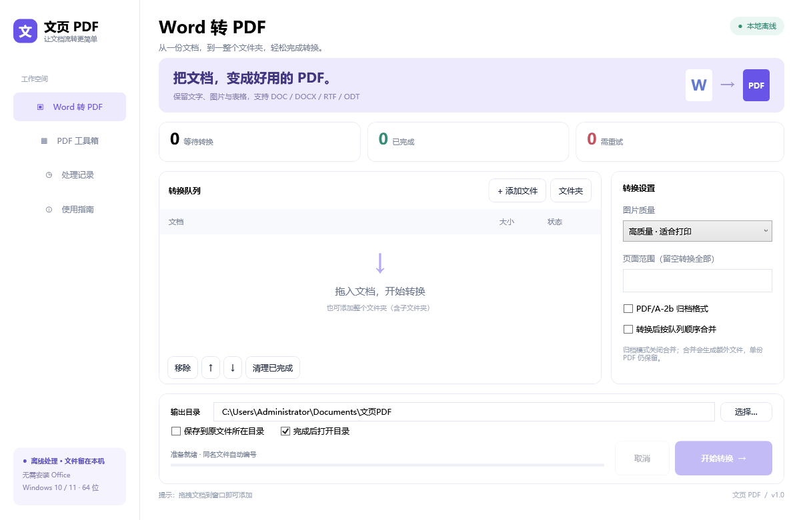
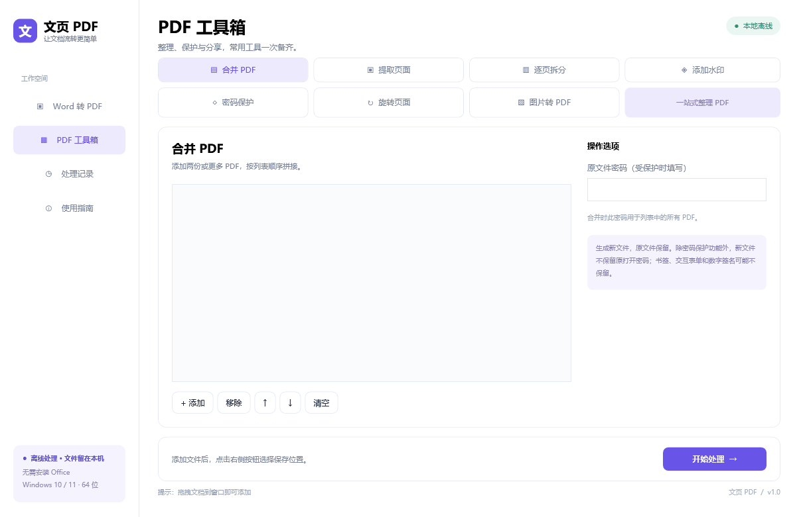

# 文页 PDF

一款面向 Windows x64 的离线 Word 转 PDF 与 PDF 工具箱。发布版是自包含的单个 EXE，普通用户无需安装 Microsoft Office、LibreOffice、.NET 或 Python，也不需要联网转换文件。

[下载最新便携版](../../releases/latest)



## 主要功能

- 批量转换 DOC、DOCX、RTF、ODT，支持文件夹导入和拖放
- 可选页码范围、PDF/A-2b、图片质量、转换后合并
- 合并、提取、拆分、旋转和加水印
- 图片转 PDF
- AES-256 PDF 密码保护
- 同名文件自动避让、失败任务隔离、历史记录和进度显示
- 全程本地处理，源文件保持不变



## 使用方法

1. 在 [Releases](../../releases) 下载 `WenyePDF-Portable-v1.0.exe`。
2. 双击运行，把文档拖入窗口或点击“添加文件”。
3. 选择输出目录和转换选项，点击“开始转换”。

第一次启动会把内置转换内核解压到当前用户的本地应用数据目录，之后直接复用。程序无需管理员权限。建议为首次解压和转换过程预留至少 1.5 GB 可用空间。

发布版尚未进行代码签名，Windows SmartScreen 可能显示未知发布者。可用 Release 中的 `SHA256.txt` 校验下载文件。

## 从源码构建

环境要求：Windows x64、PowerShell 5.1 或更高版本、.NET 10 SDK，以及构建时的网络连接。

```powershell
git clone https://github.com/HAOJ1E/word-pdf-studio.git
cd word-pdf-studio
powershell -ExecutionPolicy Bypass -File .\scripts\build-release.ps1
```

构建脚本会：

1. 从 LibreOffice 官方镜像下载 26.2.6 x64 安装包并验证 SHA-256；
2. 生成 `engine/libreoffice.zip`；
3. 以 Windows x64、自包含、单文件模式发布；
4. 把成品和校验值写入 `artifacts/release`。

转换内核与构建产物体积较大，均由 `.gitignore` 排除。应用使用 PDFsharp-GDI 6.2.4，NuGet 会在构建时恢复依赖。

## 隐私与安全

- 文档、密码与转换结果不会上传到网络。
- 每个转换任务使用独立的 LibreOffice 用户配置目录。
- 宏、外部链接、OLE/DDE 与在线更新在内置转换环境中禁用。
- 输出采用临时文件完成后再替换，避免失败时留下半成品。
- 密码不会写入历史记录或日志。

## 已知限制

- LibreOffice 与 Microsoft Word 的排版引擎不同，复杂字体、公式、浮动对象和修订内容可能产生细微分页差异。
- 当前发布版仅支持 64 位 Windows。
- PDF/A-2b 输出适用于常规归档场景；有强制合规要求时仍应使用专用验证器复核。

详细验证范围见 [测试计划](docs/TEST_PLAN.md)。第三方组件与许可见 [THIRD-PARTY-NOTICES.txt](THIRD-PARTY-NOTICES.txt) 和 [NOTO-OFL.txt](NOTO-OFL.txt)。
